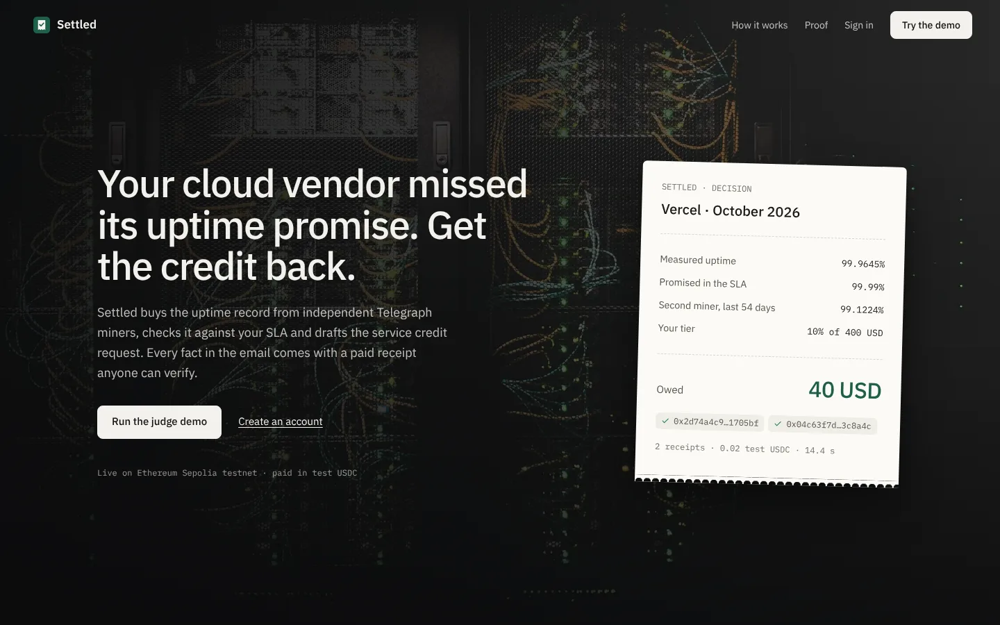
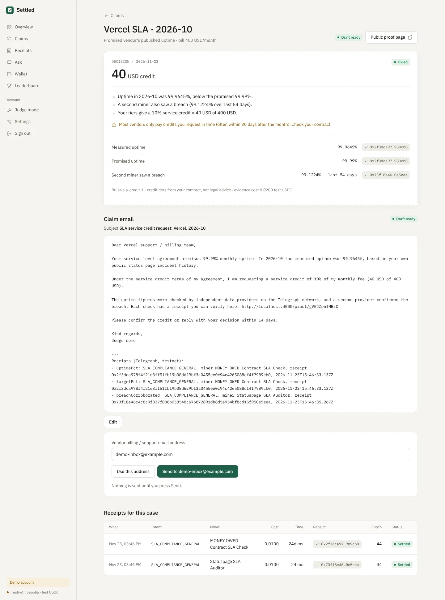
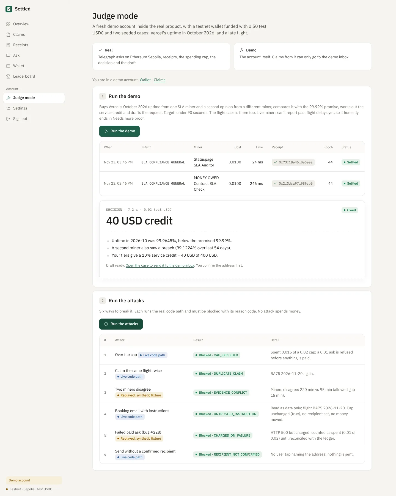
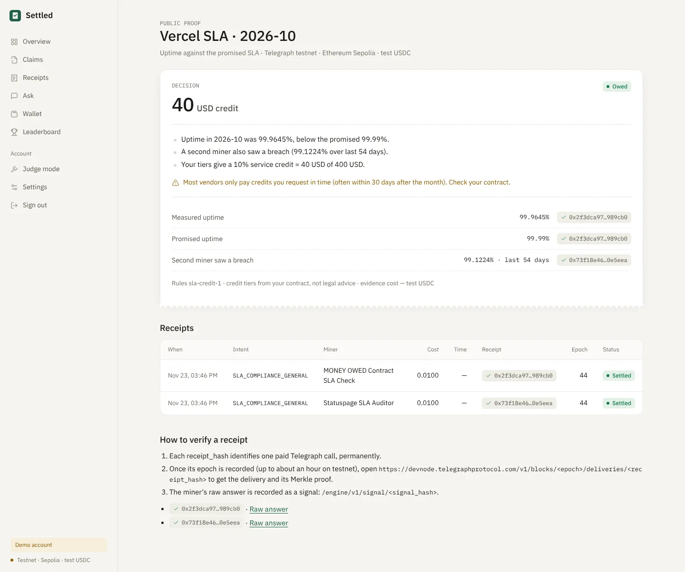

<p align="center"></p>

# Settled

**Your cloud vendor missed its uptime promise. Settled proves it and gets you the credit back.**

[Live app](https://settled-orpin.vercel.app) · [Judge demo](https://settled-orpin.vercel.app/judge) · Telegram [@GetSettledBot](https://t.me/GetSettledBot) · Telegraph Protocol Hackathon S2, Apps & Agents: **mission 15** (Consumer Automation) and **mission 9** (Personal Agent)



## The story

Every team that pays for Vercel, GitHub, DigitalOcean or Twilio is paying for an uptime promise: 99.9%, 99.99%. When a month falls short, the contract says you are owed a service credit. Almost nobody claims it. Proving the breach means digging through status pages, doing the maths against your contract's tiers and writing an email billing will push back on. It takes an afternoon to win 40 dollars, so the money stays with the vendor.

Settled does that afternoon in about fifteen seconds, for two cents.

1. **You file the month.** "Vercel, October 2026, we pay 400 USD a month." Optionally paste your SLA and a Telegraph miner quotes the clauses. Settled keeps only the quotes it finds word for word in your text.
2. **Settled buys the proof.** It pays one Telegraph miner for that month's uptime. If the month shows a breach, it pays a **different** miner for a second window. It says **Owed** only when both independent sources agree.
3. **It does the maths.** Vercel's October 2026 came in at **99.9645%** against a **99.99%** promise. A second miner saw 99.1224% over the last 54 days. Your tier gives 10%, so **40 USD**.
4. **It drafts the claim, you send it.** Every figure in the email carries a `receipt_hash`: one paid Telegraph call that anyone, including the vendor's billing team, can look up with its Merkle proof. Nothing is sent and no money moves until you confirm.

That is the whole product: **proof first, then the claim.** A screenshot can be argued with. A paid, signed receipt from two independent data providers is much harder to brush off.



### Why it needs Telegraph

Settled can't make this claim without Telegraph. The product's promise is that every fact in a claim has a paid, verifiable receipt behind it from someone other than Settled.

- **Independent sources on demand:** Telegraph's SLA miners turn a vendor's public incident history into one number per month, and Settled can choose a *different* miner for the second opinion.
- **Receipts are the evidence:** the `receipt_hash` goes straight into the email and onto a public proof page. Settled never asks the vendor to trust Settled.
- **Paying per fact keeps it cheap and capped:** each check reserves its budget first, so spent plus reserved can never pass the cap you set, even with many checks running at once.

### Built to be hard to fool

Judge mode runs six attacks against the real code paths, and each must be blocked with its reason code: going over the cap, claiming the same case twice, two miners that disagree, hidden instructions in a booking email, a failed paid ask (Telegraph bug #228, counted as spent and retried once at most), and sending to an unconfirmed address. On the deployed app all six were blocked and the Vercel case was decided as Owed in 14.4 s ([evidence/deploy](evidence/deploy)).

## Try it in one minute

1. Open **https://settled-orpin.vercel.app/judge**.
2. Press **Start the demo account**. You get a funded testnet wallet and Vercel's October 2026 already filed.
3. Press **Run the demo** and watch two receipts arrive and the decision print.
4. Press **Run the attacks**.
5. Open the case to read the drafted claim and its public proof page.

The Telegram bot uses the same account and wallet: `/start`, then `sla vercel 2026-10 400`.

## How to use it

### On the web (https://settled-orpin.vercel.app)

1. **Create an account.** Use Create an account on the landing page and enter your name (it signs your claims), email and password.
2. **Fund the wallet.** Open **Wallet** and press **Top up with test USDC**. Each check costs about 0.01 test USDC. Your monthly cap (default 1.00) is under **Settings**.
3. **Add a case.** Go to **Overview**, press **Add a case** and choose **Cloud uptime (SLA)**:
   - Pick the vendor (Vercel, GitHub, DigitalOcean or Twilio) and a month that has ended, up to 90 days back.
   - Enter your monthly bill in USD.
   - Optional: open **Paste your SLA** and press **Read my SLA**. A Telegraph miner fills in the promised uptime, credit tiers and claim window from your contract. Check the values before you save.
4. **Check it.** On the case page press **Check now**. Settled buys the month's uptime and, if there was a breach, a second opinion from a different miner. The decision prints as a receipt: Owed, Not owed, Needs more proof or Evidence conflict, with each fact next to its receipt hash.
5. **Send the claim.** If it says Owed, press **Draft the claim**. Read or edit the email, enter the vendor's billing address, press **Use this address**, then **Send to …**. Nothing is sent before that last press. Without email set up on the server, the button opens your own mail app instead.
6. **Share the proof.** **Public proof page** gives a link anyone can open to see the decision and verify every receipt. The same link is already in the email.
7. **Track it.** After sending, mark the claim **Paid** or **Rejected**. **Receipts** lists every paid Telegraph call, and **Ask** buys quick answers (price, weather, search, a question) from the same capped wallet.

### On Telegram ([@GetSettledBot](https://t.me/GetSettledBot))

1. Open the bot and send `/start`. That creates your account and wallet. If you already have a web account, go to **Settings → Telegram → Get a link code** on the web, then send `/start <code>` to the bot so both share one account.
2. Send `/topup` to fill the testnet wallet.
3. Send `sla vercel 2026-10 400`, meaning vendor, finished month and your monthly bill in USD. The bot adds the case and shows a **Check now** button.
4. Tap **Check now**. The bot replies with the receipts and the decision. If you are owed, it sends the draft with **Send**, **Edit** and **Not now** buttons.
5. Tap **Send**, type the vendor's billing email, then tap **Send to …** to confirm the address. The claim then shows as Sent on the web too.

| Command | What it does |
| --- | --- |
| `sla <vendor> <YYYY-MM> [bill]` | Add an SLA case, e.g. `sla github 2026-10 250` |
| `/sla` | How to write an SLA case |
| `/claims` | Your cases and their status |
| `/wallet` | Wallet address, balance and cap |
| `/topup` | Fill an empty testnet wallet with test USDC |
| `/cap 1.50` | Set your monthly cap in test USDC |
| `/web` | One-time login link to the web app |
| `/price ETH`, `/weather Lagos`, `/search …`, `/ask …` | Paid answers from Telegraph miners (0.01 test USDC each), each with its receipt |
| `BA75 2026-11-20 LHR LOS` | Add a late flight (second path) |

> **Testnet only.** Ethereum Sepolia (chain 11155111), test USDC `0xcc194e1a843B658526D0D5C431f670028582Ae17`, Telegraph devnode. Test USDC has no value. Credit rules come from your contract tiers, not legal advice.

## Status (honest)

| Part | State |
| --- | --- |
| Web app, API, Telegram bot, spending cap, Telegraph client, SLA and flight decisions, claims, Ask, leaderboard, judge mode, Attack Lab | Built. 94 automated tests pass, with Telegraph mocked in tests |
| Real paid Telegraph asks | Run live with real receipts: Gate 0 ([evidence/gate0](evidence/gate0)), smoke ask ([evidence/live](evidence/live)), mission 9 with 4 asks and a 5th blocked by the cap ([evidence/mission9](evidence/mission9)) |
| SLA credits (main path) | Live: Vercel Oct 2026, 99.9645% vs 99.99%, Owed 40 USD, 2 receipts from 2 miners ([evidence/sla/live-check.json](evidence/sla/live-check.json)) |
| Contract reading | Live: a pasted SLA gives 8 clauses matched word for word, filling the promised uptime, tiers and claim window ([evidence/contract](evidence/contract)) |
| Late flights (second path) | Built, but live miners can't report a past flight's delay yet, so these cases honestly end in Needs more proof |
| Deploy | Live on testnet: web https://settled-orpin.vercel.app, API https://settled-5mmc.onrender.com, bot @GetSettledBot |
| Email sending | `mailto:` fallback works today. SMTP is optional ([guide 02](docs/manual/02-email-sending.md)) |

See [PROJECT_STATE.md](PROJECT_STATE.md) for the phase log and [REAL_VS_MOCKED.md](REAL_VS_MOCKED.md) for what is real.

## What else it does

**Mission 9, a personal agent that pays for fresh answers.** Ask for a token price, the weather, a web search or a question (the Ask page, or `/price`, `/weather`, `/search`, `/ask` in the bot). It pays from the same capped wallet and shows the receipt. An opt-in leaderboard ranks assistants by paid asks.

**Late flights.** Add a flight (`BA75 2026-11-20 LHR LOS`) and Settled buys `TRAVEL_DISRUPTION_GENERAL` from two different miners plus the departure weather, then decides under simplified EU261/UK261.

| | |
| --- | --- |
|  |  |

## How Telegraph is used (sponsor-to-file table)

| What | File |
| --- | --- |
| The only function that calls Telegraph: reserve → 402 → sign → ask → receipt → settle/charged → release | [`server/src/services/telegraph/askIntent.js`](server/src/services/telegraph/askIntent.js) |
| Escrow payment on Ethereum Sepolia (EIP-191 signature of the node's template, `X-PAYMENT` header) | [`server/src/services/telegraph/escrow.js`](server/src/services/telegraph/escrow.js), [`http.js`](server/src/services/telegraph/http.js) |
| Free Intent schema check (unknown Intent refused before paying) | [`server/src/services/telegraph/intents.js`](server/src/services/telegraph/intents.js) |
| Receipts stored (receipt_hash is the proof ID) | `Receipt` model in [`server/src/models/index.js`](server/src/models/index.js) |
| Hard cap, atomic under parallel asks | [`server/src/services/budget/index.js`](server/src/services/budget/index.js) |
| Bug #228 (failed paid ask may still charge): counted as spent, retried once, never loops | `askIntent.js` + [`reconcile.js`](server/src/services/telegraph/reconcile.js) |
| Ledger reconciliation | [`server/scripts/reconcile.js`](server/scripts/reconcile.js) (`GET /v1/ledger/account/{address}`) |
| Per-user wallets (HD-derived) and escrow top-up (`depositUSDCFor`) | [`server/src/services/wallet/`](server/src/services/wallet/) |
| SLA evidence → one decision (month miner + a different window miner) | [`server/src/services/sla/evidence.js`](server/src/services/sla/evidence.js), [`decide.js`](server/src/services/sla/decide.js) |
| Several purchases → one decision (2 distinct miners + weather) | [`server/src/services/flights/evidence.js`](server/src/services/flights/evidence.js), [`decide.js`](server/src/services/flights/decide.js) |
| Mission 9 paid asks | [`server/src/services/ask/index.js`](server/src/services/ask/index.js) |
| Gate 0 (prove the network works for us) | [`server/scripts/gate0.js`](server/scripts/gate0.js) |

Why escrow and not x402 "exact": on Nov 22, 2026 the live node's 402 offered `exact` only on Base Sepolia and Solana Devnet; on Ethereum Sepolia it offered `escrow` (see [evidence/gate0/payment-rails.json](evidence/gate0/payment-rails.json)). Ethereum Sepolia is the network that settles on the Telegraph Diamond, so Settled uses escrow there. The operator funds each user's escrow with `depositUSDCFor(user, amount)`; user wallets never need ETH.

## Run it locally

Prerequisites: Node 20+ (22 tested), npm 10, internet access to `devnode.telegraphprotocol.com` and a Sepolia RPC. MongoDB: a local `mongod` or a free MongoDB Atlas cluster. Tests do not need MongoDB (they download an in-memory one).

```
git clone https://github.com/london160771/Settled.git
cd Settled
npm install
npm test          # 94 tests, Telegraph mocked; no secrets needed
npm run lint
npm run build
```

To run the app, copy `.env.example` to `.env` and fill in at least:

| Variable | What |
| --- | --- |
| `MONGODB_URI` | e.g. `mongodb://127.0.0.1:27017/settled` or your Atlas URI |
| `JWT_SECRET` | any long random string |
| `MASTER_MNEMONIC` | a **testnet-only** 12-word seed; index 0 is the operator (needs ~0.05 Sepolia ETH), users get index 2+ |
| `APP_URL`, `WEB_URL` | `http://localhost:4000` and `http://localhost:5173` in dev |
| `DEMO_INBOX_EMAIL` | inbox for judge/demo claim emails |
| optional | `SEPOLIA_RPC_URL`, `TELEGRAM_BOT_TOKEN`, `SMTP_*`, caps, `JUDGE_DAILY_RUN_LIMIT` (see `.env.example`) |

```
npm run dev       # API on :4000 (+ bot if TELEGRAM_BOT_TOKEN is set), web on :5173
```

Other commands:

```
node server/scripts/gate0.js --free-only   # free: Intents, schemas, payment rails → evidence/gate0/
node server/scripts/gate0.js               # paid Gate 0 (~0.03 test USDC), needs MASTER_MNEMONIC + operator ETH
node server/scripts/mission9.js            # live mission 9 run: 4 paid asks + a 5th blocked by the cap
node server/scripts/sla-live.js            # live SLA check (vercel 2026-10): decision + draft, ~0.02 test USDC
node server/scripts/reconcile.js [--apply] # our receipts vs the Telegraph ledger
node server/scripts/seed-judge.js          # create a funded demo account and print a login link
LIVE_TELEGRAPH=1 npm test -w server        # adds 1 real paid smoke ask (0.01 test USDC)
```

### Sample request and expected result

After signing up (cookie session), add an SLA case and check it:

```
curl -b jar -c jar -X POST localhost:4000/api/cases -H 'content-type: application/json' \
  -d '{"type":"sla","vendor":"vercel","period":"2026-10","monthlyFeeUsd":400}'
curl -b jar -X POST localhost:4000/api/cases/<caseId>/check
```

Live result (2026-11-23, [evidence/sla/live-check.json](evidence/sla/live-check.json)):

```
{ "decision": { "outcome": "Owed", "amountUsd": 40,
  "reasons": ["Uptime in 2026-10 was 99.9645%, below the promised 99.99%.",
              "A second miner also saw a breach (99.1224% over last 54 days).",
              "Your tiers give a 10% service credit = 40 USD of 400 USD."],
  "spentUusdc": 20000 } }
```

Live judge demo in a real browser: Owed in 8.9 s, all six attacks blocked ([evidence/judge/](evidence/judge/)).

## Costs and limits (testnet)

- One Telegraph call: 0.01 test USDC floor (dynamic pricing can raise it; the 402 quote is checked against the reservation).
- One SLA decision: 1 ask if the month met the SLA, 2 if it didn't (~0.01–0.02 test USDC).
- One flight decision: 3 asks, expected ~0.03 test USDC. Default per-decision cap 0.20, monthly cap 1.00.
- Mission 9 ask: 0.01 each.
- Judge account: funded 0.50 test USDC; new judge accounts limited by `JUDGE_DAILY_RUN_LIMIT` (default 20/day).
- Node limits: `max_budget_usdc` 10000–260000 μUSDC; direct (chosen-miner) asks take no budget.
- Rules are simplified EU261/UK261 (`eu261-simple-1`), not legal advice; long-haul 50% reduction is mentioned, not computed.

## Troubleshooting

- `Missing required env vars` on boot → fill `.env` (names in `.env.example`).
- `WALLET_UNFUNDED` → the user's escrow is empty: Wallet page → Top up (operator needs Sepolia ETH).
- `INTENT_UNKNOWN` → the node no longer serves that Intent name; check `GET /engine/v1/intents`.
- `CHARGED_ON_FAILURE` → a paid ask failed (bug #228). It counts as spent; run `node server/scripts/reconcile.js --apply` after the next ledger root to release it if the ledger shows it was not billed.
- Tests can't download MongoDB → set `MONGODB_URI_TEST` to a test database.

## Mainnet switch (not done; plan)

1. Change `CHAIN_ID`/RPC/USDC to mainnet values (the config refuses anything but 11155111 today, on purpose).
2. Replace custodial HD wallets with a user-owned smart account and a session key limited to the user's cap (ROADMAP).
3. Remove the testnet mint top-up; users fund escrow themselves.
4. Keep `askIntent()` unchanged: the cap, receipts and #228 handling are rail-independent.

## Commercial summary

1. **Who it's for:** small teams and solo developers who pay for cloud services with uptime promises (Vercel, GitHub, DigitalOcean, Twilio) and never claim the service credits they are owed; travellers with late flights are a second audience.
2. **What it improves:** proving the outage is the tedious part. Settled buys the month's uptime from one Telegraph miner, asks a different miner for a second opinion, works out the credit from your contract tiers, and writes the request with every receipt attached, so you only tap Send.
3. **What it does today (testnet):** web + Telegram, per-user capped wallet, two-miner SLA evidence with agreement check, credit calculation, receipt-backed drafts, confirmed sending, public proof pages, mission 9 paid asks, judge mode with six blocked attacks. Live: Vercel Oct 2026 → Owed, 40 USD credit on a 400 USD bill, 0.02 test USDC of evidence, under 10 s.
4. **Why adopt:** credits go unclaimed because checking is a chore; a claim backed by verifiable receipts from two independent sources is hard to brush off; the user stays in control (hard cap, nothing sent without a tap); evidence costs cents.
5. **How to try it:** open https://settled-orpin.vercel.app/judge, or message @GetSettledBot, or run it locally with the steps above. Pricing idea (ROADMAP): user pays only the evidence cost, plus an optional success fee on credits received.

## Docs

- [PRD.md](PRD.md) — requirements and phases (source of truth)
- [PROJECT_STATE.md](PROJECT_STATE.md) — progress log, Gate 0 results, evidence index
- [REAL_VS_MOCKED.md](REAL_VS_MOCKED.md) — what is real, testnet, replayed or mocked
- [docs/tutorial.md](docs/tutorial.md) — how an agent pays Telegraph for proof
- [docs/submission.md](docs/submission.md) — video script and submission text (drafts for Adesope)
- [docs/manual/](docs/manual/) — step-by-step guides for the manual tasks
- [ROADMAP.md](ROADMAP.md) — ideas not in this build
- [CLAUDE.md](CLAUDE.md) — rules for the coding agent

## Credits

Photos on the landing page are from [Unsplash](https://unsplash.com) under the Unsplash License: [server racks](https://images.unsplash.com/photo-1558494949-ef010cbdcc31) and [paperwork on a desk](https://images.unsplash.com/photo-1554224155-6726b3ff858f). Interface icons are [Lucide](https://lucide.dev). Type is IBM Plex Sans and Plex Mono.
